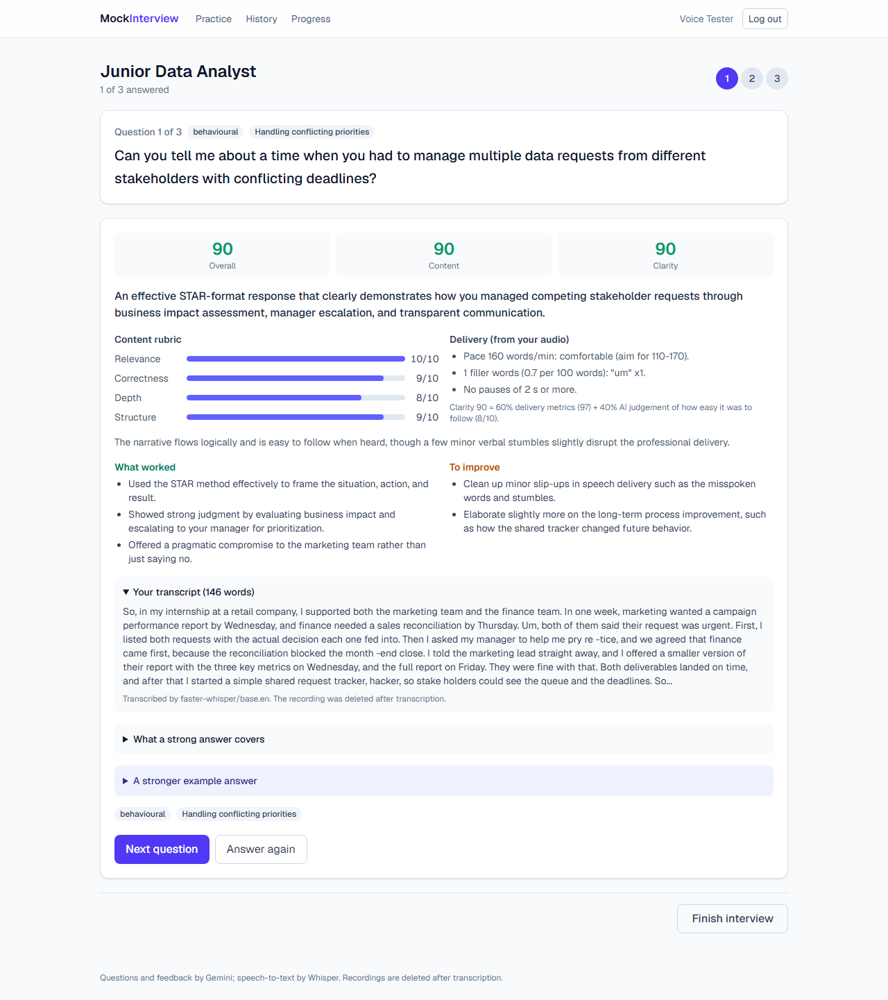
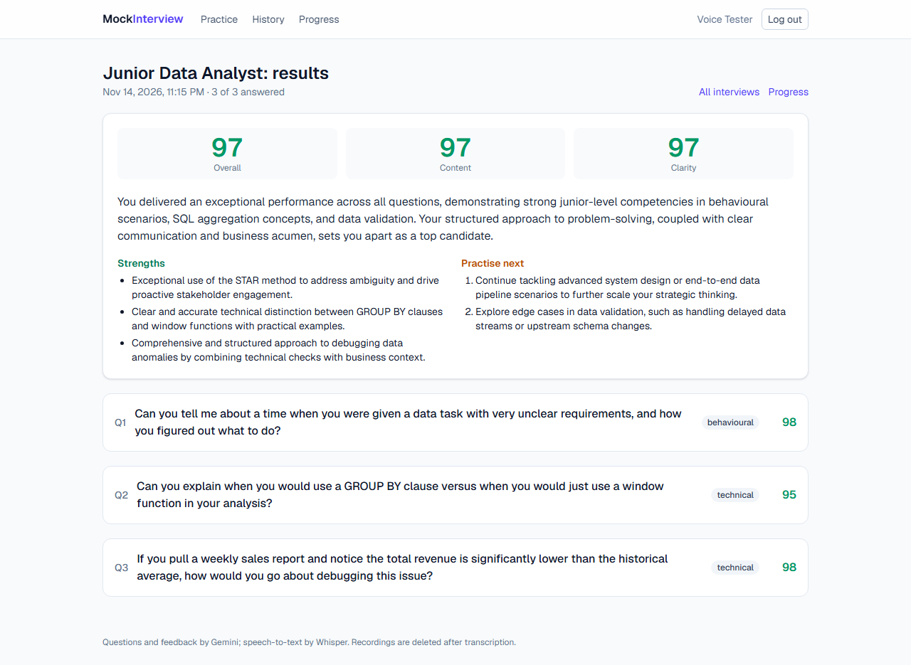
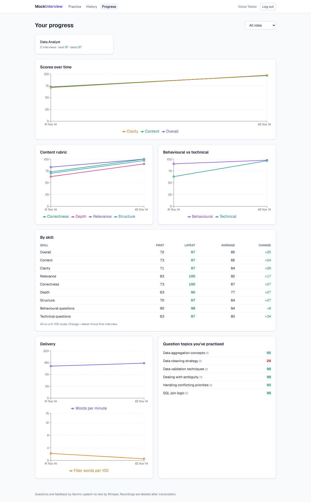
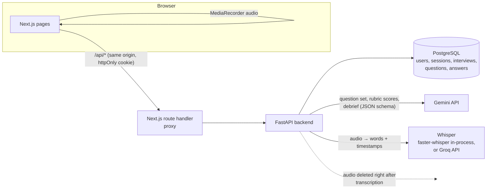

# AI Mock Interview

Practise job interviews out loud: pick a role and level, answer AI-generated questions by voice, and
get scored feedback on **what** you said (Gemini, against a fixed rubric) and **how clearly** you
said it (Whisper word timings: pace, filler words, pauses). Your history and progress are tracked
over time.

Next.js · FastAPI · PostgreSQL · Gemini API · Whisper (faster-whisper) · Docker

**Live demo:** https://ai-mock-interview-cyan-psi.vercel.app (free tier: the first request after
~5 idle minutes takes a few seconds while the backend wakes up; the Gemini free tier has a daily
quota). Sign up with any email; it isn't verified. Use Chrome, Edge, Firefox or Safari and allow
the microphone.



| Results and debrief | Progress over time |
|---|---|
|  |  |

All screenshots are from the real app (real Gemini, real Whisper) during the real-voice runs below
(local, plus [one from the live site](docs/img/live_results.png)).

## How it works



1. **Sign up / log in** (argon2id passwords, httpOnly session cookie).
2. **Choose a role and level** (8 roles, intern → senior, 3–8 questions). Gemini writes a mix of
   behavioural and technical questions as structured JSON, avoiding ones you've had before.
3. **Answer each question by voice** in the browser. The backend transcribes it with Whisper (word
   timestamps), deletes the recording, measures delivery, and asks Gemini to score the content.
4. **Feedback per question**: overall / content / clarity scores, the four rubric dimensions,
   delivery notes, strengths, improvements, your transcript, and a stronger example answer.
5. **Finish** for an overall debrief; see every interview in **History** and your trends by role
   and skill in **Progress**.

### Scoring

| Score | How |
|---|---|
| Content (0–100) | Gemini scores relevance, correctness, depth and structure 0–10 against written anchors; mean × 10 |
| Clarity (0–100) | 60 % measured from the audio (pace outside 110–170 wpm, filler words per 100 words, pauses ≥ 2 s) + 40 % Gemini's "easy to follow" score |
| Overall (0–100) | 70 % content + 30 % clarity |

The measured part is plain arithmetic in [`clarity.py`](backend/src/interview_api/clarity.py), so
every point can be explained. Weights are settings. Details and alternatives:
[docs/DECISIONS.md](docs/DECISIONS.md).

## Results

### Real-voice run (2026-11-14, `docker compose up`, real Gemini + real Whisper)

Two Junior Data Analyst interviews for one user, answered through the browser's real
MediaRecorder → upload → Whisper → Gemini path. The "voice" is speech synthesised with Windows'
built-in text-to-speech from answers written for the questions Gemini asked, played into Chromium
as its microphone ([`frontend/e2e-voice/`](frontend/e2e-voice/README.md)). The first interview
deliberately includes one weak, hesitant answer.

| Interview | Question (Gemini) | Answer given | Words / wpm | Fillers found | Pauses ≥ 2 s | Content | Clarity | Overall |
|---|---|---|---|---|---|---|---|---|
| 1 | Conflicting stakeholder deadlines (behavioural) | Solid STAR answer | 146 / 160 | 1 (um) | 0 | 90 | 90 | **90** |
| 1 | Left join vs inner join (technical) | Strong, with a pitfall | 136 / 196 | 0 | 0 | 100 | 92 | **98** |
| 1 | Handling missing values (technical) | Weak: "just drop them", 5 scripted fillers, 2 pauses | 33 / 91 | 6 | 2 (longest 3.7 s) | 28 | 31 | **29** |
| 2 | Unclear requirements (behavioural) | Solid STAR answer | 127 / 156 | 1 (um) | 0 | 98 | 98 | **98** |
| 2 | GROUP BY vs window functions (technical) | Strong | 133 / 164 | 0 | 0 | 95 | 96 | **95** |
| 2 | Debugging a revenue drop (technical) | Strong, structured | 131 / 168 | 1 (see note) | 0 | 98 | 98 | **98** |

- **Interview scores:** 72 → 97 overall (the weak answer drags interview 1 down), which is what the
  Progress page charts.
- **The rubric separates good from weak answers** (98 vs 29 in the same interview) and the
  feedback is specific. For the weak answer Gemini asked for an analysis of the missingness
  pattern, the business context, and imputation options beyond the mean.
- **The fast answer (196 wpm) lost clarity points** although its content scored 100. That's the
  measured pace rule working.
- **Filler words:** all 7 scripted fillers ("um" ×4, "uh", "like", "basically") were kept by
  Whisper and detected. The 6th filler in row 3 is a real artefact: Chromium loops the audio file,
  so the recording ended with the first "Um" again. The note on row 6: the run counted "known
  causes, *like* a holiday" as a filler; the rule was fixed afterwards and a test added. Re-scoring
  the stored word timings with the fixed rule: 0 fillers, overall 97.7 → 98.2; every other row is unchanged.
  TTS speaks fillers clearly; real hesitations are mumbled, and Whisper may drop more of them.
- **Speed:** feedback appeared **3.5–12.1 s** after "Submit" (upload + Whisper `base.en` on CPU +
  Gemini `gemini-3.5-flash-lite`), on Docker Desktop with 12 CPUs. Whisper `base.en` alone
  transcribed 21.5 s of speech in 2.2 s; `small.en` took 4.5 s with an identical transcript.
- **Privacy check:** after the run, no audio files were left in the container and every answer
  row has `audio_kept = false`.
- **Caveat:** these are LLM judgements, not calibrated against human interviewers, and the answers
  were written by the developer. They show that the pipeline works and discriminates, not how
  accurate the scores are.

### Live deployment run (2026-11-15, Vercel, real Gemini + real Whisper)

The same browser harness against the deployed URL: a new user signed up, took a Junior Backend
Developer interview (3 questions) and answered with synthesised speech written for the questions
Gemini asked; the second answer has scripted fillers ("um" ×2, "like", "uh") and a 2.5 s pause.

| Question (Gemini) | Words / wpm | Fillers found | Pauses ≥ 2 s | Content | Clarity | Overall | Feedback after Submit |
|---|---|---|---|---|---|---|---|
| Critical feedback on a pull request (behavioural) | 123 / 156 | 0 | 0 | 90 | 92 | **91** | 10.8 s |
| Database indexes and when not to add one (technical) | 125 / 148 | 4 (all scripted ones) | 1 (3.4 s) | 93 | 80 | **89** | 11.2 s |
| PUT vs PATCH (technical) | 107 / 139 | 0 | 0 | 95 | 96 | **95** | 9.7 s |

- **Interview: 92 overall** (content 93, clarity 89), shown in History and Progress
  ([screenshot](docs/img/live_results.png)).
- Transcription ran in the deployed backend container (faster-whisper `base.en`, 2 GB / 1 vCPU);
  every answer row has `audio_kept = false`.
- **Cold start:** after more than 6 idle minutes the first API request took **5.9 s** (warm: 0.8 s).
- Whisper slips on synthetic speech: "pull request" once came out as "pool request", and the
  harness stopped recording just before each clip ended, which garbled the last word or two.

### Tests

- Backend: **92 pytest tests** against PostgreSQL (Gemini, Groq and Whisper mocked), including
  per-user isolation, rate limits, audio deletion, upload limits and two race conditions.
- Frontend: typecheck, ESLint, production build.
- End-to-end: **3 Playwright tests** against the Docker Compose stack with mocked AI and Chromium's
  fake microphone: the full happy path (sign up → 3 voice answers → feedback → finish → history →
  progress), microphone permission denied, and upload failure → retry.
- All of it runs in GitHub Actions on every push.

## Quickstart

Needs Docker (Desktop) and git. Works the same in Windows PowerShell and macOS/Linux shells.

```bash
git clone https://github.com/washedhunter/ai-mock-interview.git
cd ai-mock-interview
cp .env.example .env
docker compose up --build
```

Then open http://localhost:3000 and sign up.

- **Add your Gemini API key** (free from [Google AI Studio](https://aistudio.google.com/)) to
  `GEMINI_API_KEY` in `.env` before `docker compose up` for real questions and feedback. Without a
  key the app runs in a clearly labelled **demo mode** (canned questions and feedback; transcription
  and delivery metrics are still real).
- The first build downloads the Whisper model into the backend image (142 MB for `base.en`).
- On Gemini's free tier, Google may use what you send (your answer transcripts) to improve its
  products. Don't use it for anything sensitive.
- Stop with `Ctrl+C`; `docker compose down -v` also deletes the database.

## Development

```bash
# Backend tests (need a throwaway Postgres on port 55432)
docker run -d --rm --name mi-testdb -p 55432:5432 -e POSTGRES_PASSWORD=postgres postgres:17
cd backend
uv sync
uv run ruff check .
uv run pytest
```

```bash
# Frontend checks
cd frontend
npm ci
npm run typecheck
npm run lint
npm run build
```

```bash
# End-to-end tests against the stack with mocked AI (from the repo root, then in frontend/)
docker compose -f compose.yaml -f compose.e2e.yaml up --build --detach --wait
cd frontend
npx playwright install chromium
npx playwright test
```

API docs (Swagger) are at http://localhost:3000/api/docs while the stack runs.

### Configuration

All settings are environment variables (see [.env.example](.env.example) and
[`config.py`](backend/src/interview_api/config.py)): Gemini model, `TRANSCRIBER`
(`local` faster-whisper / `groq` / `mock`), `WHISPER_MODEL`, `KEEP_AUDIO`, rate limits, scoring
weights, cookie security.

## Deployment

Live on **Vercel** (free Hobby plan) as one project with two
[Vercel Services](https://vercel.com/docs/services), configured in [`vercel.json`](vercel.json):

| Service | What runs | Reachable |
|---|---|---|
| `frontend` | the Next.js app, built by Vercel | public (all routes) |
| `backend` | **the same `backend/Dockerfile`** as Docker Compose, on Vercel's container runtime (Whisper `base.en` baked in, `alembic upgrade head` on start, 2 GB / 1 vCPU) | private: only the frontend, via a service binding that sets `BACKEND_URL` |

PostgreSQL is **Neon** (free plan) from Vercel's Neon integration, which sets `DATABASE_URL`.

Steps used (Vercel CLI, from the repo root):

```bash
npm i -g vercel
vercel login
vercel link --yes --project ai-mock-interview      # detects the two services in vercel.json
vercel integration add neon --billing-plan free_v3 --meta region=iad1 --meta auth=false
vercel env add GEMINI_API_KEY --environment production --sensitive   # paste the key at the prompt
vercel env add PORT --environment production --value 8000 --yes      # the backend container's port
vercel env add ENABLE_API_DOCS --environment production --value false --yes
vercel env add MAX_AUDIO_BYTES --environment production --value 4000000 --yes
vercel env add MAX_UPLOAD_BYTES --environment production --value 4000000 --yes
vercel deploy --prod
```

What the platform changed in the app (all small, all covered in [DECISIONS.md](docs/DECISIONS.md#hosting)):

- Request bodies are capped at 4.5 MB, so the recorder records Opus at 32 kbit/s (~1 MB for
  4 minutes) and uploads over 4 MB are refused with a clear message.
- Containers scale to zero after ~5 idle minutes and several can start at once, so migrations take
  a Postgres advisory lock.
- The internal hop from frontend to backend rewrites `X-Forwarded-For`, which made every visitor
  share one per-IP rate-limit bucket. Found on the live site and fixed: the proxy passes the client
  IP in its own header (details in DECISIONS.md).

[`.vercelignore`](.vercelignore) keeps `.env` files out of CLI uploads.

## Project structure

```
backend/                      FastAPI service (Python 3.12, uv)
  src/interview_api/
    main.py                   app, error handling, Whisper warm-up
    auth.py  ratelimit.py     argon2id + cookie sessions; sliding-window rate limits
    models.py  schemas.py     SQLAlchemy models; API request/response models
    ai/gemini.py              the only module that talks to Gemini (questions, scoring, debrief)
    ai/transcribe.py          faster-whisper (local) and Groq Whisper transcribers
    ai/mock.py                canned AI for tests, e2e and demo mode
    clarity.py  scoring.py    delivery metrics; how scores combine
    routers/                  auth, interviews (+ answer upload), progress, meta/health
  alembic/                    database migrations
  tests/                      pytest suite
frontend/                     Next.js 16 (App Router, TypeScript, Tailwind)
  src/app/                    pages: landing, login/signup, dashboard, interview, results, history, progress
  src/app/api/[...path]/      same-origin proxy to the backend
  src/components/Recorder.tsx MediaRecorder state machine with error handling
  e2e/                        Playwright end-to-end tests (mocked AI)
  e2e-voice/                  real-voice run tooling (real AI)
compose.yaml                  db + backend + frontend
compose.e2e.yaml              override: mocked AI for end-to-end tests
docs/DECISIONS.md             why things are built this way
```

## Design decisions and trade-offs

- **Same-origin proxy** instead of CORS: the browser only talks to the Next.js app, so the session
  cookie is first-party and httpOnly, and the backend URL is a runtime setting.
- **Score each answer right away** with a synchronous request (3.5–12 s measured) rather than a job queue:
  simpler, and a failure costs one answer, not the interview.
- **LLM for content, arithmetic for delivery:** the measured clarity part is reproducible and
  explainable; the LLM covers what metrics can't.
- **Whisper model baked into the image**, so containers start without downloading anything.
- **In-memory rate limiting**, which is right for one backend replica. More replicas (or
  Vercel's per-instance scaling) would need a shared store.
- **Fixed role list** keeps progress comparable and free text out of the question prompt.

More in [docs/DECISIONS.md](docs/DECISIONS.md).

## Limitations and next steps

- Scores are an LLM's judgement; no calibration against human interviewers yet. Next: a small
  labelled set of answers to measure agreement.
- English only (`*.en` Whisper models). Accents and real disfluencies weren't measured: the
  real-voice run used synthetic speech.
- Transcription runs inside the request. Very long answers on a slow CPU would want a background
  job with progress polling.
- Rate limits live in process memory: exact for one replica, per instance on Vercel (and reset by
  a new deployment). A global hourly cap on AI calls protects the free Gemini quota, but a
  determined abuser can still use it up for an hour. Next: move the counters to Postgres.
- The live demo runs on free tiers: the backend scales to zero when idle, and the Gemini free tier
  has a daily quota, so the demo can be slow to wake or temporarily out of quota.
- No email verification or password reset.

## License

MIT, see [LICENSE](LICENSE).
